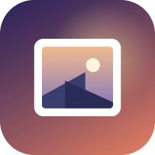

<p align="center"></p>

<h1 align="center">photo-frame</h1>

<p align="center">
Clock / Weather / Music display app for android or anything with a html file.
</p>

<p align="center">
<a href="https://l1vef4stdieyoung.github.io/photo-frame/?demo"><b>Try the demo</b></a> ·
<a href="https://l1vef4stdieyoung.github.io/photo-frame/"><b>Open it in your browser</b></a> ·
<a href="https://github.com/l1vef4stdieyoung/photo-frame/releases/latest/download/photo-frame.apk"><b>Download the Android app</b></a>
</p>

---

## Contents

- [What it does](#what-it-does)
- [Getting started](#getting-started)
- [First-run setup](#first-run-setup)
- [Using it](#using-it)
- [Settings](#settings)
- [Connecting services](#connecting-services)
- [The Android app](#the-android-app)
- [Privacy](#privacy)
- [How it works](#how-it-works)
- [Running your own copy](#running-your-own-copy)
- [Development](#development)
- [Known limitations](#known-limitations)
- [Credits](#credits)

---

## What it does

###  Home screen
A tile layout you return to from every screen.
- **Live photo tile:** slowly cross-fades through your photos, or shows the Wikimedia picture of the day.
- **Live weather tile:** a small animated copy of the real sky, with sun, moon phase, stars, clouds, rain or snow.
- **Now playing tile:** shows the current song and its zoomed in album art.
- **Clock tile:** Here you can enter the clock faces that are available in this app.
- **Calendar tile (optional):** today's and tomorrow's events; tap it for a two-week agenda.
- **Greeting line:** the date, plus the public holidays of your country and name days (in about 20 countries).
- **Backgrounds:** animated, one of 8 built-in gradients, or your own picture. The background you pick is shown right away, in setup and in Settings.
- **Colour theme (optional):** the whole interface (icons, buttons, highlights) takes on a colour that matches your background. With your own picture, the colour is picked from the picture.

###  Photo slideshow
- **Your own photos:** pick a folder (or a batch of files) and it shuffles through them. You choose the time per photo, the transition length and the style: fade, slide, zoom, slow zoom (Ken Burns), or a mix.
- **Portrait pairs:** two portrait photos are shown side by side on a landscape screen.
- **Photo details:** camera, lens, aperture, shutter speed, ISO and date, read from the photo's EXIF data.
- **Favourites and hiding:** press and hold a photo to make it a favourite (shown more often) or to hide it.
- **Saved on the device:** a screen-sized copy of each photo is stored, so the slideshow starts by itself after a restart.
- **No photos chosen?** It shows the Wikimedia Commons picture of the day.

###  Now Playing
- **Music sources:**
  - **Last.fm** shows whatever you are currently scrobbling on last.fm.
  - **Spotify** adds play, pause and skip buttons and shows how much of the song is left.
- **Large album art:** up to 1200 × 1200, using Apple's iTunes catalogue artwork when it matches.
- **Moving album covers:** in the Android app, albums that have an animated cover on Apple Music play it in place of the picture. It only plays while Now Playing is on screen, and can be turned off in **Settings → Music**.
- **Background:** blurred colours taken from the cover.
- **Background to the beat (beta):** the colours swirl with the music and get a push on every beat. Choose where the beat comes from:
  - **Tempo** (default): the song's speed from Deezer. It can be a little ahead of or behind the real beat.
  - **Spotify:** also uses where you are in the song, so it lines up better (only when the music source is Spotify).
  - **Microphone:** the tablet listens to the music playing in the room and hits the beat exactly. The sound is analysed on the device and never recorded or sent anywhere (Android app 2.2.0 or newer, or a browser).
  - **Off.**
- **Lyrics** from LRCLIB.
- **Clock:** it can move out of the way while music plays.
- **Automatic switching:** Now Playing opens when music starts, and the frame returns to the Home screen a while after it stops.

###  Weather
- **Overview:** temperature, conditions, feels-like, high and low, wind, humidity, sunrise and sunset. The background is an animated sky that matches the real time of day and weather.
- **Tabs:**
  - **24-hour forecast:** a temperature graph plus an hourly strip with the chance of rain.
  - **Sun:** daylight arc, golden hour, civil dawn and dusk.
  - **Moon:** a drawn moon in the real phase, moonrise and moonset, distance, and the zodiac constellation it's in.
  - **Rain radar:** the last 2 hours, animated over a map centred on your town.
- **Warnings:** strong gusts, heavy rain or snow, storms, freezing rain, heat, cold and fog. **Official warnings** are shown where available: most of Europe through MeteoAlarm (HungaroMet in Hungary; Android app only) and the US through the National Weather Service.
- **Providers:** Open-Meteo (free, no key), the paid Open-Meteo API, or OpenWeatherMap.
- **Sky events:** at golden hour, sunrise, moonrise, a full moon or during storms, the matching view opens by itself. 5 minutes after the event it goes back Home, unless you've picked another screen in the meantime.

###  Clock
- **12 clock faces:** Minimal, Analog, Stacked, Rings, Words (natural English and Hungarian), Flip (split-flap), Binary, Daylight (a 24-hour dial with today's real daylight), Tape (a moving measuring tape of time), Dot matrix (an amber LED board), Aura (colours that follow the time of day) and Night (red): a big, dim red clock and date on black that won't light up a dark bedroom.
- **Timer:** with a countdown visible on every screen.
- **Alarm:** every day or once, with a 9-minute snooze.

###  QOL Features
- **Brightness Control:** You can set the app to automatically lower either your devices brightness in the android app or the htmls brightness according to your own schedule, sunset and sunrise, your devices camera or light sensor. you can also set how much the brightness is turned up or down. Tapping the screen brightens it for 5 seconds; the darker it is, the smaller the step, so it doesn't blind you at night (beta).
- **Night screen:** between the hours you choose, the frame shows the red night clock or turns the screen black (with the lowest backlight in the app). A tap shows the normal screen for a minute; alarms still ring. In the morning it goes back Home.
- **Away mode:** a black screen with a slowly drifting clock, to protect the screen from burn-in.
- **Seasonal touches:** holidays, name days, and gentle snow on the screen from December to early January (northern hemisphere only).
- **Units and formats:** °C or °F, km/h, mph or m/s, and a 12- or 24-hour clock. Setup suggests them from your country.
- **Accessibility:** larger text (or the device's own text size in the app) and a high-contrast look. If the device asks for reduced motion, animations start switched off.
- **PIN lock:** a 4-digit PIN in front of Settings and setup, so children or guests can't change anything. It's a simple lock, not real security.
- **Backup and restore:** save your settings to a file (Downloads in the app) or copy them as a code, and restore them on another device or after a reinstall.
- **Languages:** English and Hungarian, switchable at any time.
- **Light performance mode for slow tablets:** no frosted-glass blur, lower frame rates and smaller images. It's chosen automatically on weak devices, based on the device detected in setup.

---

## Getting started

Pick whichever suits your device.

| Way | Best for | How |
|---|---|---|
| **Demo** | a quick look, no setup | Open **https://l1vef4stdieyoung.github.io/photo-frame/?demo** |
| **Browser** | trying it out, any device | Open **https://l1vef4stdieyoung.github.io/photo-frame/** |
| **Installed web app** | iPad, any tablet | Open the link, then *Add to Home screen* (Safari: Share button; Chrome: ⋮ menu). It opens full screen and works offline. |
| **Android app** | a dedicated Android wall tablet | Install the APK (see [The Android app](#the-android-app)) for start on boot, real brightness control and more. |


### The demo
The demo link opens the frame ready to go, without setup: sample photos with their camera details, music playing, a demo calendar, and live weather for Budapest. It starts with *Pacify Her* by Melanie Martinez to show off a moving album cover (this one works in any browser, because the demo already knows where it is), then plays a few made-up songs with their own covers and lyrics. Look around, open Settings and change anything. Nothing is saved, and your own settings and photos (if you already use the frame in this browser) aren't touched. *Exit demo* goes back to the normal frame.

The demo photos are public-domain (CC0) pictures from Wikimedia Commons. *Pacify Her*'s cover and moving cover are loaded from Apple Music, as in normal use; the demo doesn't show its lyrics. The other songs, their artist, lyrics and covers were made up for the demo. Details are in [docs/demo/CREDITS.md](docs/demo/CREDITS.md).
---

## First-run setup

A guided setup appears the first time you open it. A list on the left shows the steps; tap a finished step to go back to it.

- **Welcome:** English or Hungarian (Magyar). You can also **restore a backup** here and skip the rest.

1. **Device:** the setup detects whether it's a tablet, phone, PC, Mac, iPad or iPhone (in the Android app also the exact model, memory and processor cores), and you can correct it. Based on that it recommends a **performance** mode: Automatic, Best visuals, or Light for slower tablets.
2. **Location:** search for your city or tap *Use my location*, and choose a weather provider.
3. **Region & units:** shows what your country gets (holidays, name days, official warnings) and lets you choose °C/°F, the wind unit and the clock format. These are suggested from your country.
4. **Photos:** choose your photos, the time per photo and the transition, and whether to keep them saved on the device.
5. **Music:** Last.fm, Spotify, or no music.
6. **Look:** Home background (shown behind the setup as soon as you pick it) and matching colours, Now Playing background and what it follows to the beat (tempo, Spotify, microphone or off), photo transition style, what the Photos tile shows.
7. **Night & comfort:** screen brightness, the night screen (red clock or black) and its hours, text size and high contrast.
8. **Extras & lock:** sky-event jumps, edge swiping, opening Now Playing automatically, and an optional PIN for Settings.

The last page sums up your choices.

Everything can be changed later in **Settings**.

---

## Using it

### Touch
| Gesture | What it does |
|---|---|
| Tap anywhere | Shows the controls (the Home button, the weather tabs) for a few seconds |
| Swipe left / right on a photo | Next / previous photo |
| Swipe left / right on Weather | Next / previous weather tab |
| Swipe from the *screen edge* | Switch between Photos → Now Playing → Weather → Clock |
| Press and hold a photo | Favourite it, or hide it |
| Tap the dimmed screen | Brightens it for 5 seconds (only a little at night) |

### Keyboard (handy on a PC)
| Key | Action |
|---|---|
| ← / → | Previous / next photo |
| Space | Pause / resume the slideshow |
| P · N · W · H · S · M | Photos · Now Playing · Weather · 24-hour forecast · Sun · Moon |
| L | Lyrics |
| A | Away mode on/off |
| F | Full screen |
| Home | Home screen |
| Esc | Back / close |

---

## Settings

Settings is organised in tabs:

- **General:** language, performance mode, animations, screen brightness, night screen, text size and contrast, edge swiping.
- **Photos:** time per photo, transitions, portrait pairs, EXIF, saved photos (with "Remove saved photos" and "Show hidden photos again"), picture of the day.
- **Music:** source (Last.fm or Spotify), Now Playing behaviour, background liveliness, background to the beat (tempo, Spotify, microphone or off), clock position.
- **Weather:** location, provider and API key, sky timelapse, automatic sky-event views, warnings.
- **Region:** units (°C/°F, wind, 12/24-hour clock) and what your country gets: holidays, name days and official warnings.
- **Home & calendar:** Home background (previewed live; *Cancel* puts the old one back), colour theme, calendar link, seasonal touches.
- **Advanced:** a time-of-day preview for the weather sky, debug mode, running setup again, the PIN lock, backup and restore, beta updates, *Report a problem*, app version and updates (in the Android app), and credits.

---

## Connecting services

All of these are optional. Without any keys you still get photos, the clock, Open-Meteo weather, radar, the moon, and the picture of the day.

### Last.fm (shows what you play anywhere)
1. Create a free API key at **https://www.last.fm/api/account/create**.
2. Enter your Last.fm username and the key in setup or in **Settings → Music**.

Last.fm needs your player to scrobble. Spotify, and most players can do this.

### Spotify (adds playback controls and the time left)
1. Go to **https://developer.spotify.com/dashboard**, create an app and select **Web API**.
2. Add the **Redirect URI** that the frame shows in **Settings → Music**:
   - **Android app:** `photoframe://spotify`
   - **Browser:** the exact address of the page, for example `https://l1vef4stdieyoung.github.io/photo-frame/`
3. Paste the app's **Client ID** into the frame and tap **Connect Spotify**.

Things to know:
- **Premium:** play, pause and skip need Spotify Premium. Showing the song and time left works without it.
- **https only:** in a browser, Spotify only allows logins from `https://` addresses (or `http://127.0.0.1`).
- **Switching:** the music source only changes to Spotify once the login has actually worked. If Spotify is chosen but not connected, Last.fm keeps showing your music (when it's set up).
"
⚠️ ***THIS FEATURE STILL NEEDS TO BE TESTED, IT IS POSSIBLE IT DOESN'T WORK AT ALL. IF YOU NOTICE A BUG IN THIS (ALSO ANYWHERE IN THE APP) YOU SHOULD CONTACT ME, THE REPO AUTHOR*** ⚠️

### Weather providers
- **Open-Meteo (free):** the default; no key needed.
- **Open-Meteo API:** paste the key from your Open-Meteo customer account.
- **OpenWeatherMap:** create a free key at openweathermap.org (*My API keys*). New keys can take up to two hours to start working.

Use **Test connection** to check a key before saving. If a paid provider stops working, the frame falls back to free Open-Meteo.

### Calendar
Paste an **iCal (.ics) link** in **Settings → Home & calendar**:
- **Google Calendar:** Settings → your calendar → *Secret address in iCal format*.
- **iCloud:** share the calendar as a public calendar and copy the link.

In a browser, some calendar servers refuse to be read by web pages; *Test link* button will tell you. You can then add a CORS proxy address, or use the Android app, which isn't affected.

---

## The Android app

The app is a lightweight shell around the same frame. It loads the published page, so **the frame updates itself**. The shell adds:

- **Starts on boot:** it opens by itself after the tablet restarts (allow it in **Settings → Advanced → Android app**).
- **Real brightness:** night dimming lowers the actual backlight.
- **Always on and full screen:** the screen never sleeps, and the status and navigation bars are hidden.
- **In-app Spotify login** through `photoframe://spotify`.
- **Update check:** when a new app version exists, the frame offers to download it.
- **Saving backups** to the Downloads folder, and following the tablet's own text size (app 2.0.0 and newer).
- **Moving album covers** start on their own on every Android version (app 2.1.0 and newer).
- **Microphone** for the background to the beat (app 2.2.0, beta). Android asks for permission the first time you choose it.

### Installing
1. On the tablet, download **[photo-frame.apk](https://github.com/l1vef4stdieyoung/photo-frame/releases/latest/download/photo-frame.apk)** from the latest release.
2. Open it. Android asks you to allow installing apps from your browser or file manager; allow it.
3. Open **photo-frame** and go through setup.
4. To start on boot: **Settings → Advanced → Android app → Allow starting when the tablet turns on**, then enable *Display over other apps*.

It requires Android 7 or newer. It was tested on a Galaxy Tab A7 running LineageOS 21 (Android 14), Confirmation of the app working on other devices appriciated :)

### Updates
- **The frame (almost every change):** arrives by itself. The app reloads when a new version is published, at a quiet moment, and also every night at 4:00.
- **The app shell (rare):** the frame shows *App update available*. Tap it, download, and confirm the install.
- **Beta updates:** turn on **Settings → Advanced → Updates → Get beta updates** to get new versions before everyone else. They may have bugs; turn it off to go back to the normal version.

### Found a bug?
Use **Settings → Advanced → Report a problem**. It prepares a GitHub issue with the frame version, the device and recent errors (no API keys, logins or location), and you can read everything before sending. Without a GitHub account, use *Copy report* and send it another way.

---

## Privacy

- **No accounts, no analytics, no tracking.** There's no server of our own: the frame is a static page.
- **Everything stays on your device:** settings, API keys, saved photos, favourites and hidden photos are stored only in the device's browser or app storage.
- **Microphone (only if you choose it):** used only while Now Playing is showing, to find the beat. The sound is analysed on the device, never recorded, stored or sent anywhere.
- **Your photos are never uploaded anywhere.** They're read and resized on the device.
- **Data goes straight to the services you use.** The frame talks directly to the services you enable, and only sends them what they need (your city's coordinates for the weather; your Last.fm username and key; Spotify login tokens; the song's artist and title for artwork, lyrics and tempo).

Services that may be contacted: Open-Meteo (weather, city search), OpenWeatherMap (if chosen), MeteoAlarm (official warnings, Android app), the Apple Music website (moving album covers, Android app), the US National Weather Service (US warnings), Nager.Date (public holidays), RainViewer and OpenStreetMap (radar), Last.fm, Spotify, Apple iTunes Search (artwork), LRCLIB (lyrics), Deezer (tempo), Wikimedia Commons (picture of the day), nameday.abalin.net (name days), BigDataCloud ("Use my location" and region lookup), and your calendar's server.

---

## How it works

```
┌────────────────────────┐        ┌───────────────────────────────────────┐
│  docs/index.html       │  ───▶  │  GitHub Pages                         │
│  (the whole frame:     │        │  https://…github.io/photo-frame/      │
│   one HTML file)       │        │  + service worker (offline copy)      │
└────────────────────────┘        └──────────────────┬────────────────────┘
                                                     │ loads
                    ┌────────────────────────────────┼─────────────────────────┐
                    ▼                                ▼                         ▼
              any browser                  installed web app          Android app (Capacitor)
                                                                       + native "Frame" plugin
```

- **One file:** the whole frame is a single self-contained HTML file (HTML, CSS and JavaScript, no build step), so it's easy to host anywhere and to edit.
- **Offline:** a small **service worker** keeps a copy of the frame. It always asks the server for a newer version first, so updates arrive on the next reload, and the frame still starts without internet.
- **Version check:** `docs/version.json` tells running frames that a new version exists (`web`) and which Android app version is current (`apk`).
- **Beta channel:** `docs/beta/` holds the beta copy with its own `version.json`. Frames with beta updates on are sent there when they load; `docs/404.html` sends them back if the beta copy is missing. An app version can be released to beta only too: when the `release-channel` file says `beta`, GitHub publishes it as a pre-release and only `docs/beta/version.json` offers it. The publisher's *Beta only* box and *Promote beta to everyone* button handle this.
- **The Android app** is a Capacitor shell that loads the hosted page. Its native `Frame` plugin provides `setBrightness`, `httpGet` (network requests without browser restrictions), `getInfo` (app version, device details and the system text size), `openUrl`, `requestOverlay`, `saveFile` (backups to Downloads) and the light sensor (`startLight`, `getLight`, `stopLight`). A boot receiver starts it after a restart. The page detects the app (`isApp()`) and uses these features only when they're available, so the same file works everywhere.
- **Builds:** GitHub Actions builds a signed APK whenever the app shell changes, and publishes it as `photo-frame.apk` on the latest release.

### Repository layout
```
docs/                 the published frame (GitHub Pages)
  index.html          the frame itself
  version.json        current web + app versions
  sw.js               offline service worker
  beta/               the beta copy (same files, its own version.json)
  404.html            sends a frame back to the normal version if beta is missing
  manifest.webmanifest, icons
android/              Capacitor Android project
  app/src/main/java/…/MainActivity.java   full screen, keep awake, Spotify return link
  app/src/main/java/…/FramePlugin.java    native helpers for the page
  app/src/main/java/…/BootReceiver.java   start after boot
www/                  the app's built-in offline page
capacitor.config.json app id, hosted address, user-agent tag
.github/workflows/android.yml  automatic signed APK builds
```

---

## Running your own copy

1. **Fork** this repository.
2. In your fork: **Settings → Pages →** deploy from the `main` branch, `/docs` folder. Your frame is now at `https://<you>.github.io/photo-frame/`.
3. That's enough for the web version. For your own Android app, also:
   - Replace `l1vef4stdieyoung.github.io/photo-frame` with your address in:
     - `capacitor.config.json`
     - `android/app/src/main/java/…/MainActivity.java` (`BASE`)
     - `www/offline.html`
     - the `BASE` constant near the end of `docs/index.html`
   - Optionally change `appId` and the package name to your own.
   - Create a signing key:
     ```bash
     keytool -genkeypair -keystore photo-frame.jks -alias photoframe -keyalg RSA -keysize 3072 -validity 18250 -storetype PKCS12
     ```
   - Add the repository secrets `KEYSTORE_B64` (the `.jks` file in base64), `KEYSTORE_PASSWORD`, `KEY_ALIAS` and `KEY_PASSWORD`.
   - Run the **Build Android app** workflow. Your APK appears under Releases.

> Keep your signing key safe and backed up. Every app update must be signed with the same key.

---

## Development

- **Editing:** change `docs/index.html` directly. You can open it straight from disk in Chrome to try it out; app-only features are simply skipped there.
- **Publishing a frame update:** bump `window.WEB_VERSION` in `docs/index.html` **and** `"web"` in `docs/version.json` to the **same** value, then push. Running frames notice it and reload. To try a version on beta first, put it in `docs/beta/` instead. The publisher (`Publish.cmd`) can do both, and its *Promote beta to everyone* button copies beta over.
- **Releasing an app update:** raise `versionName` in `android/app/build.gradle`, set the same value as `"apk"` in `docs/version.json`, and push. GitHub builds and publishes the APK.
- **Debugging on a device:** turn on **Settings → Advanced → Debug mode** for an on-screen info panel. The Android app also allows Chrome remote debugging over USB (`chrome://inspect`).

---

## Known limitations

- **Android folder picking:** Android's in-app file picker can't choose a whole folder, so select your photos as a batch. They're then kept on the device.
- **Song tempo:** this comes from Deezer, which doesn't have it for every song. Those songs swirl slowly without a beat (unless the microphone hears one). The tempo is kept in a calm 70–140 BPM range, so it may show half or double the real value.
- **Official warnings:** MeteoAlarm (Europe) only works in the Android app, because it blocks web pages. Outside Hungary the frame matches your area by place name, which doesn't always succeed; then only forecast-based warnings are shown. The US alerts work everywhere.
- **Spotify controls** need Spotify Premium.
- **Moving album covers** only work in the Android app, because Apple's album pages refuse requests from other websites. There's no official free way to get them: the frame reads the public Apple Music album page, so it may stop working if Apple changes that page. Each moving cover uses a few MB of data.
- **iPhone and iPad:** there's no native app. Use the installed web app.

---

## Credits

Weather: [Open-Meteo](https://open-meteo.com/) · Warnings: [MeteoAlarm](https://meteoalarm.org/) / HungaroMet, [National Weather Service](https://www.weather.gov/) · Holidays: [Nager.Date](https://date.nager.at/) · Radar: [RainViewer](https://www.rainviewer.com/) · Map: © [OpenStreetMap](https://www.openstreetmap.org/copyright) contributors · Lyrics: [LRCLIB](https://lrclib.net/) · Tempo: [Deezer](https://developers.deezer.com/) · Artwork: Apple iTunes Search, Last.fm · Picture of the day: [Wikimedia Commons](https://commons.wikimedia.org/) · Name days: [abalin.net](https://nameday.abalin.net/) · App shell: [Capacitor](https://capacitorjs.com/) · Font: [Manrope](https://fonts.google.com/specimen/Manrope)
